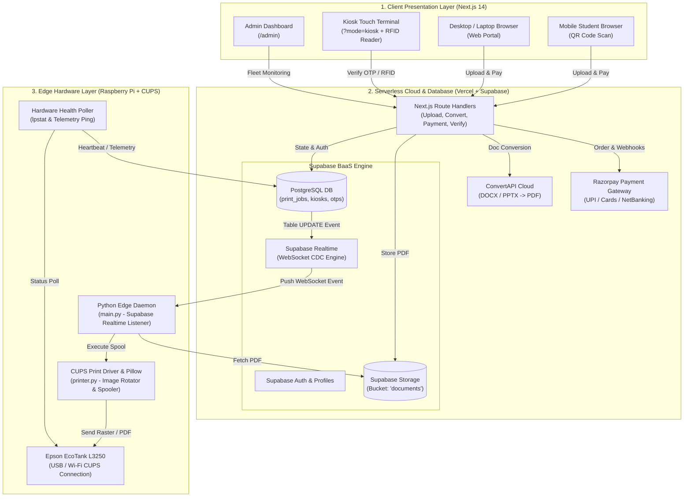
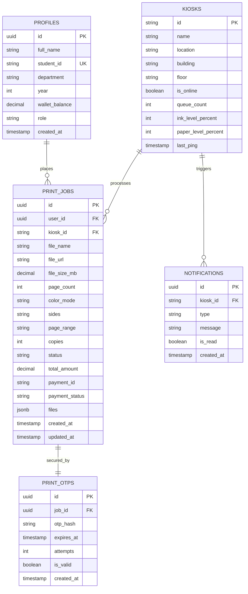
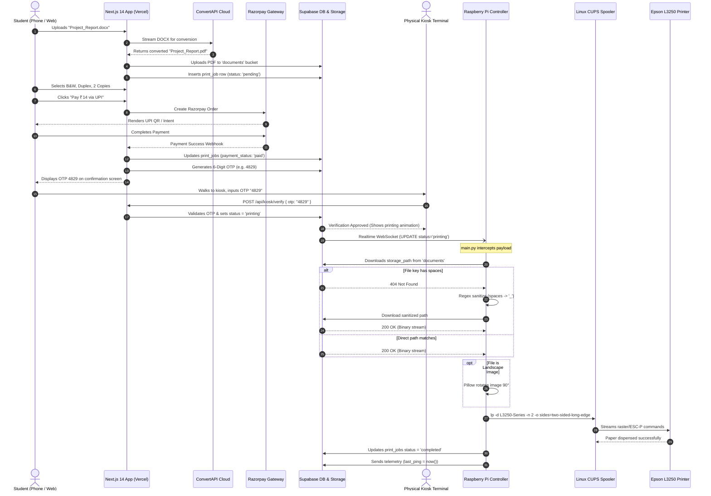

# PriKIO 2.0 — End-to-End System Architecture Specification

> **Target Audience:** Systems Architects, Software Engineers, and Generative Visual Diagramming AIs (Eraser.io, Mermaid, PlantUML, Claude, ChatGPT).  
> **Repository:** `Srishant74/PriKIO-2.0`  
> **Production Deployment:** [https://prikio.vercel.app](https://prikio.vercel.app)

---

## 1. Executive System Overview

**PriKIO 2.0 (CampusPrint)** is a distributed, self-service campus printing system designed for zero-install client accessibility, cloud-native job management, and resilient edge execution. 

### High-Level Ecosystem Topology



---

## 2. Four-Tier Architecture Breakdown

```
┌────────────────────────────────────────────────────────────────────────┐
│ TIER 1: CLIENT PRESENTATION LAYER                                      │
│ • Next.js 14 App Router (React, Tailwind CSS, Lucide, Framer Motion)   │
│ • Zustand State Store (`usePrintStore`, `useAppStore`)                 │
│ • Client-Side PDF.js Engine (`pdfjs-dist` Web Worker)                  │
│ • Dual-Interface: Web User Flow vs. Touch Terminal (`?mode=kiosk`)     │
└────────────────────────────────────┬───────────────────────────────────┘
                                     │ HTTPS / JSON / WebSockets
┌────────────────────────────────────▼───────────────────────────────────┐
│ TIER 2: SERVERLESS API ROUTING LAYER (Vercel)                          │
│ • `/api/upload` (Fast path Signed URLs & Fallback Multipart Upload)    │
│ • `/api/convert` (Background ConvertAPI engine for Office documents)   │
│ • `/api/calculate-cost` (Pricing engine: B&W ₹2, Color ₹10, Duplex)    │
│ • `/api/payment/*` (Razorpay order creation, verification, webhooks)   │
│ • `/api/kiosk/verify` (OTP validation & release status changer)        │
│ • `/api/kiosk/rfid` (Fast 10-digit Student ID auto-login)              │
│ • `/api/kiosk/heartbeat` & `/api/admin/*` (Fleet health & Telemetry)   │
└────────────────────────────────────┬───────────────────────────────────┘
                                     │ PostgreSQL / Storage API
┌────────────────────────────────────▼───────────────────────────────────┐
│ TIER 3: CLOUD DATA & STORAGE LAYER (Supabase)                          │
│ • PostgreSQL Database (`print_jobs`, `profiles`, `otp_sessions`, etc.) │
│ • S3-Compatible Cloud Storage (`documents` bucket)                     │
│ • Realtime Engine (Change-Data-Capture / WebSocket Broadcast)          │
│ • Row-Level Security (RLS) & Secure Public Anonymous Tokens            │
└────────────────────────────────────┬───────────────────────────────────┘
                                     │ WSS (Outbound Reverse Tunnel)
┌────────────────────────────────────▼───────────────────────────────────┐
│ TIER 4: PHYSICAL EDGE CONTROLLER LAYER (Raspberry Pi 4)                │
│ • Python 3 Virtual Environment (`main.py`, `printer.py`)               │
│ • Async Realtime Event Listener (`supabase.acreate_client`)            │
│ • File Downloader with 3-Tier Path Sanitization Fallback               │
│ • Pillow (PIL) Image Pre-processor (Landscape 90° rotation)            │
│ • Linux CUPS Spooler (`lp` driver with Duplex / Color options)         │
│ • Physical Printer: Epson EcoTank L3250                                │
└────────────────────────────────────────────────────────────────────────┘
```

---

## 3. Detailed Component Directory & File Mapping

### Presentation & Application Core (`/src`)
| Path | Primary Function | Key Dependencies |
| :--- | :--- | :--- |
| `src/app/page.tsx` | Landing page & router. Switches between student upload CTA and desktop landing. | `framer-motion`, `lucide-react` |
| `src/app/upload/page.tsx` | Drag-and-drop file upload zone. Computes page counts in browser. | `react-dropzone`, `pdfjs-dist` |
| `src/app/print-settings/page.tsx` | Granular per-file print configuration (copies, B&W/color, duplex, range). | `usePrintStore` |
| `src/app/review/page.tsx` | Summary invoice card showing subtotal, tax, and pricing breakdown. | `calculate-cost.ts` |
| `src/app/payment/page.tsx` | Razorpay checkout overlay + Kiosk UPI QR scan fallback. | `loadRazorpay.ts` |
| `src/app/status/page.tsx` | Confirmation screen with **6-Digit OTP** and live queue status polling. | Supabase REST |
| `src/app/kiosk/page.tsx` | Physical terminal interface with full-screen keypad for OTP entry & printing animations. | Kiosk CSS, Web Audio |
| `src/store/usePrintStore.ts` | Persistent Zustand store preserving file arrays, settings, and session TTL. | `zustand/middleware` |

### API Handlers (`/src/app/api`)
| Route | Method | Purpose |
| :--- | :--- | :--- |
| `/api/upload` | `POST` | Generates signed upload URLs for browser uploads, or accepts multipart forms and initiates ConvertAPI for non-PDFs. |
| `/api/convert` | `POST` | Converts `.docx`, `.pptx`, `.jpg`, `.png` to `.pdf` via ConvertAPI and updates DB records. |
| `/api/calculate-cost` | `POST` | Validates custom page ranges (e.g., `1-3, 5`) and calculates billing totals. |
| `/api/payment/create-order` | `POST` | Communicates with Razorpay SDK to create an official `order_id`. |
| `/api/payment/verify` | `POST` | Validates Razorpay HMAC SHA256 payment signature. |
| `/api/kiosk/verify` | `POST` | Validates 4-to-6 digit OTP, marks `print_jobs.status = 'printing'`. |
| `/api/kiosk/rfid` | `POST` | Looks up student ID from 10-digit USB RFID reader keystroke scan. |
| `/api/kiosk/heartbeat` | `POST` | Receives ping, paper level %, and ink level % from edge hardware. |

### Edge Raspberry Pi Controller (`/pi`)
| File | Responsibility | Key Mechanics |
| :--- | :--- | :--- |
| `pi/main.py` | Edge Daemon Entry Point | 1. Subscribes to Supabase Realtime `public:print_jobs` updates.<br/>2. Spawns `poll_printer` daemon thread polling CUPS `lpstat`.<br/>3. Dispatches jobs to `printer.py` when `status == 'printing'`.<br/>4. Sends periodic telemetry updates to `kiosks.last_ping`. |
| `pi/printer.py` | Print Spooler Engine | 1. Downloads file from Supabase Storage bucket `documents`.<br/>2. **3-Stage Retry Fallback**: Direct path -> Regex underscore replacement -> Directory listing lookup.<br/>3. **Pillow Pre-processor**: Checks EXIF/Dimensions; rotates landscape photos by 90° for CUPS.<br/>4. **CUPS Dispatch**: Constructs `lp` CLI command with `-o sides=two-sided-long-edge` / `-o print-color-mode=monochrome`.<br/>5. Updates Supabase record to `completed`. |
| `pi/.env` | Hardware Config | `SUPABASE_URL`, `SUPABASE_KEY`, `KIOSK_ID=LIB-04`, `PRINTER_NAME=L3250-Series`. |
| `pi/requirements.txt` | Edge Python Deps | `supabase>=2.4.0`, `Pillow>=10.0.0`, `requests==2.31.0`, `python-dotenv==1.0.1`. |

---

## 4. Database Schema Specification (Supabase PostgreSQL)



### State Machine for `print_jobs.status`:
$$\text{pending} \xrightarrow{\text{Payment OK}} \text{paid / queued} \xrightarrow{\text{OTP / RFID Verified}} \text{printing} \xrightarrow{\text{CUPS Spool OK}} \text{completed}$$
*(Alternate branches: $\text{failed}$, $\text{refunded}$)*

---

## 5. End-to-End Sequence Diagram

This sequence details the complete lifecycle from when a student taps their phone to when ink hits paper:



---

## 6. Key Engineering Safeguards & Edge Edge-Cases

### 1. Reverse-Tunnel Architecture (Bypassing Campus Firewalls)
* **Problem:** In a university or commercial network, kiosks and printers sit behind corporate NATs, firewalls, and dynamic IP routers. A cloud server cannot directly ping or send print jobs to `192.168.x.x`.
* **Solution:** The Raspberry Pi opens an **outbound persistent WebSocket connection** to Supabase Realtime using TLS (`wss://`). Because the connection originates from *inside* the local network, campus firewalls allow it without opening inbound ports.

### 2. The 3-Tier Download Fallback (`printer.py`)
* **Attempt 1 (Direct Path):** Requests the original file path recorded in the DB (`36d05d07.../My Notes.pdf`).
* **Attempt 2 (Regex Sanitization):** If Attempt 1 returns 404 (due to cloud S3 sanitization rules), it strips spaces and special characters into underscores (`36d05d07.../My_Notes.pdf`).
* **Attempt 3 (Folder Scrape):** If still not found, it queries `supabase.storage.list(job_id)` to dynamically discover the exact filename stored in the job's directory.

### 3. Image Orientation Pre-Processing (`Pillow`)
* **Problem:** Linux CUPS generic raster drivers frequently distort or crop landscape images uploaded by mobile users.
* **Solution:** [printer.py](file:///d:/projects/Prikio/pi/printer.py#L68-L76) reads image dimensions with **Pillow**. If `orientation == 'landscape'` and the file is `.jpg` or `.png`, it rotates the image 90° clockwise in memory and saves it before spooling.

### 4. Fleet Telemetry & Self-Healing Loop
* **Heartbeat:** Every 60 seconds, `main.py` polls CUPS via `lpstat -p L3250-Series`.
* **Telemetry Ping:** Updates `kiosks.last_ping`, `ink_level_percent`, and `paper_level_percent` in Supabase.
* **Smart Plug Power Cycle:** If the printer remains in an `active` or `now printing` state for $>300\text{ seconds}$ without finishing (indicating a frozen print buffer), `main.py` triggers an IoT Smart Plug power cycle to reboot the printer.

---

## 7. Recommended Tools to Render This Architecture

| AI / Platform | Purpose | Input Format |
| :--- | :--- | :--- |
| **Eraser.io** | Generates professional diagram graphics for pitch decks and technical documentation. | Paste the diagrams from Section 1 & Section 5. |
| **Mermaid Live Editor** | Instant interactive vector diagrams (SVG / PNG). | Copy any `mermaid` code block from this document. |
| **Claude / ChatGPT** | Deep-dive code generation or refactoring. | Feed this complete document as system context. |
| **Draw.io / PlantUML** | Manual block editing and infrastructure layout. | Use the component tables in Section 3. |
